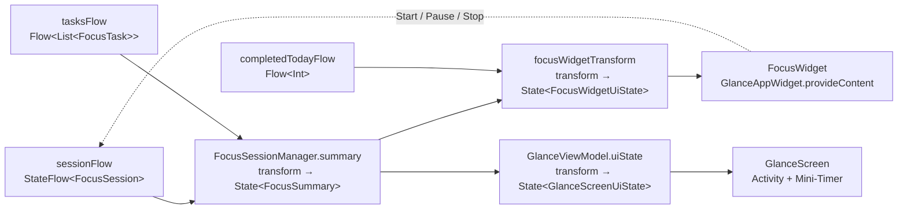

# Glance Widget Recipe (`transform` with `GlanceAppWidget` and Nested Transforms)

This recipe demonstrates how to define a `transform` for a Jetpack Glance home-screen widget (`GlanceAppWidget`) and compose **nested `transform` blocks** across multiple UI surfaces:
- **`FocusSessionManager.summary`**: A shared headless `transform` that combines a timer `StateFlow<FocusSession>` and `TaskRepository.tasksFlow` into `State<FocusSummary>` using dynamic read tracking.
- **`focusWidgetTransform`**: A widget-specific nested `transform` scoped to `FocusWidget.provideGlance` that combines `FocusSessionManager.summary` with `completedTodayFlow` into a UI-ready `State<FocusWidgetUiState>`.
- **`GlanceViewModel.uiState`**: A companion screen nested `transform` that combines `FocusSessionManager.summary` with local screen state (`isMiniTimerExpanded`).



---

## Comparing `transform` vs. `Flow.combine` + `stateIn` for Glance Widgets

Both approaches derive state for an in-app screen and a home-screen `GlanceAppWidget`, but they differ in subscription behavior, boilerplate, and how Glance observes state.

### Side-by-Side Code

```kotlin
// Coroutine Flow approach
class FocusSessionManager(
    taskRepository: TaskRepository,
    appScope: CoroutineScope,
) {
    val summary: StateFlow<FocusSummary> = combine(
        sessionFlow,
        taskRepository.tasksFlow,
    ) { session, tasks ->
        if (session.phase == FocusPhase.Idle) {
            FocusSummary.Idle
        } else {
            val task = tasks.find { it.id == session.activeTaskId }
            FocusSummary.Active(...)
        }
    }.stateIn(
        scope = appScope,
        started = SharingStarted.WhileSubscribed(5_000),
        initialValue = FocusSummary.Idle,
    )
}

class FocusWidget : GlanceAppWidget() {
    override suspend fun provideGlance(context: Context, id: GlanceId) {
        val container = FocusContainer.get(context)
        provideContent {
            val summary by container.focusManager.summary.collectAsState()
            val completedToday by container.taskRepository.completedTodayFlow.collectAsState(0)
            GlanceTheme {
                FocusWidgetContent(summary = summary, completedToday = completedToday)
            }
        }
    }
}
```

```kotlin
// AppState Transform approach
class FocusSessionManager(
    private val taskRepository: TaskRepository,
    scope: CoroutineScope,
) {
    val summary: State<FocusSummary> = transform<FocusSummary>(
        initialValue = FocusSummary.Idle,
        scope = scope,
    ) { previous ->
        val session by sessionFlow.collectAsState()
        if (session.phase == FocusPhase.Idle) {
            return@transform FocusSummary.Idle
        }
        val tasks = taskRepository.tasksFlow.collectAsState(initial = null).value
            ?: return@transform previous
        val task = tasks.find { it.id == session.activeTaskId }
        FocusSummary.Active(...)
    }
}

class FocusWidget : GlanceAppWidget() {
    override suspend fun provideGlance(context: Context, id: GlanceId) {
        val container = FocusContainer.get(context)
        coroutineScope {
            val widgetState = focusWidgetTransform(
                summaryState = container.focusManager.summary,
                completedTodayFlow = container.taskRepository.completedTodayFlow,
                scope = this,
            )
            provideContent {
                val uiState by widgetState
                GlanceTheme { FocusWidgetContent(uiState = uiState) }
            }
        }
    }
}
```

---

### Direct Differences

#### 1. Direct `State<T>` Reads in Glance `provideContent`
- **`Flow.combine` + `stateIn`**: Exposes a `StateFlow<T>` that each consumer (`FocusWidget.provideContent`, Compose screens, downstream ViewModels) must convert back into Compose state via `collectAsState()` or re-combine with `Flow.combine`.
- **`transform`**: Produces a Compose `State<T>` directly. Because Jetpack Glance's `provideContent` runs a Compose runtime `Composition` backed by the snapshot system, reading `val uiState by widgetState` registers snapshot tracking automatically and recomposes the widget's `RemoteViews` whenever `uiState` changes.

#### 2. Dynamic Upstream Subscription (`return@transform` While Idle)
- **`Flow.combine`**: Unconditionally subscribes to *all* upstream flows (`sessionFlow` and `tasksFlow`) as soon as a collector subscribes, even when `session.phase == FocusPhase.Idle` and the task list is unused.
- **`transform`**: Tracks dependencies dynamically per execution path. Returning early when `session.phase == FocusPhase.Idle` skips `tasksFlow.collectAsState(...)`, so `tasksFlow` has zero active collectors until a focus session starts—and is automatically cancelled when the session returns to `Idle`.

#### 3. Nested Transforms Across Surfaces
- Instead of duplicating `combine(sessionFlow, tasksFlow)` across the Activity `ViewModel`, mini-timer, and `FocusWidget`, `FocusSessionManager.summary` computes `State<FocusSummary>` once.
- Each surface layers a lightweight nested `transform` for its own UI concerns:
  - **`focusWidgetTransform`**: Combines `summary` with `completedTodayFlow` and formats labels, progress, and button actions into `FocusWidgetUiState` off the main thread (`Dispatchers.Default`).
  - **`GlanceViewModel.uiState`**: Combines `summary` with `isMiniTimerExpanded` to compute `showMiniTimerControls = expanded && summary is FocusSummary.Active`.

#### 4. Scoping to `provideGlance` and Waking Idle Widget Sessions
- **`coroutineScope` inside `provideGlance`**: Passing `scope = this` inside `coroutineScope { ... provideContent { ... } }` ties `focusWidgetTransform` to the exact lifetime of the active Glance worker session. When Glance closes the session (~45 seconds after interaction stops), `coroutineScope` cancels and disposes the headless composition cleanly.
- **Waking idle widgets with `listener` + `updateAll`**: While a Glance session is active, snapshot reads in `provideContent` update the widget automatically. When a state change originates from the app while no Glance worker session is running, `FocusContainer` uses `androidx.appstate.transform.listener` to call `FocusWidget().updateAll(appContext)` if any widget is placed on the home screen. (`updateAll` wakes an idle session without restarting an already-running `provideGlance` session.)

#### 5. Pure JVM Unit Testing with `transformTest`
- Putting stream collection and state derivation directly inside `GlanceAppWidget.provideContent` couples widget business logic to Glance's `AppWidgetSession` runtime.
- Defining the widget's state producer as `focusWidgetTransform(...)` allows testing every widget state transition (`Idle`, `Focusing`, `Paused`, countdown ticks, and `completedToday` updates) deterministically on the JVM using `transformTest`, `backgroundScope`, and `testDispatcher`—with no Robolectric or `AppWidgetHost` setup.

---

## How It Works

1. **`FocusSessionManager`** ([`GlanceTransform.kt`](GlanceTransform.kt)):
   - Runs the countdown loop and exposes `summary: State<FocusSummary>` via `transform`, dynamically collecting `TaskRepository.tasksFlow` only during active/paused sessions.
2. **`focusWidgetTransform`** ([`GlanceTransform.kt`](GlanceTransform.kt)):
   - Reads `summaryState` and collects `completedTodayFlow` inside a nested `transform` to produce `State<FocusWidgetUiState>`.
3. **`FocusWidget` & `ActionCallback`s** ([`FocusWidget.kt`](FocusWidget.kt)):
   - `FocusWidget.provideGlance` scopes `focusWidgetTransform` to `coroutineScope` and renders `FocusWidgetUiState` with Glance Material 3 components (`Scaffold`, `FilledButton`, `OutlineButton`, `LinearProgressIndicator`).
   - Tapping **Start / Pause / Resume** or **Stop** on the home-screen widget runs `FocusWidgetPrimaryActionCallback` / `FocusWidgetStopActionCallback`, mutating `FocusSessionManager` so both the widget and any open Activity screen stay synchronized.
4. **`FocusContainer`** ([`FocusGraph.kt`](FocusGraph.kt)):
   - Shares `FocusSessionManager` and `InMemoryTaskRepository` across `GlanceActivity` and `FocusWidget` in-process, and uses `listener` to trigger `FocusWidget().updateAll(appContext)` when state changes while widgets are placed.
