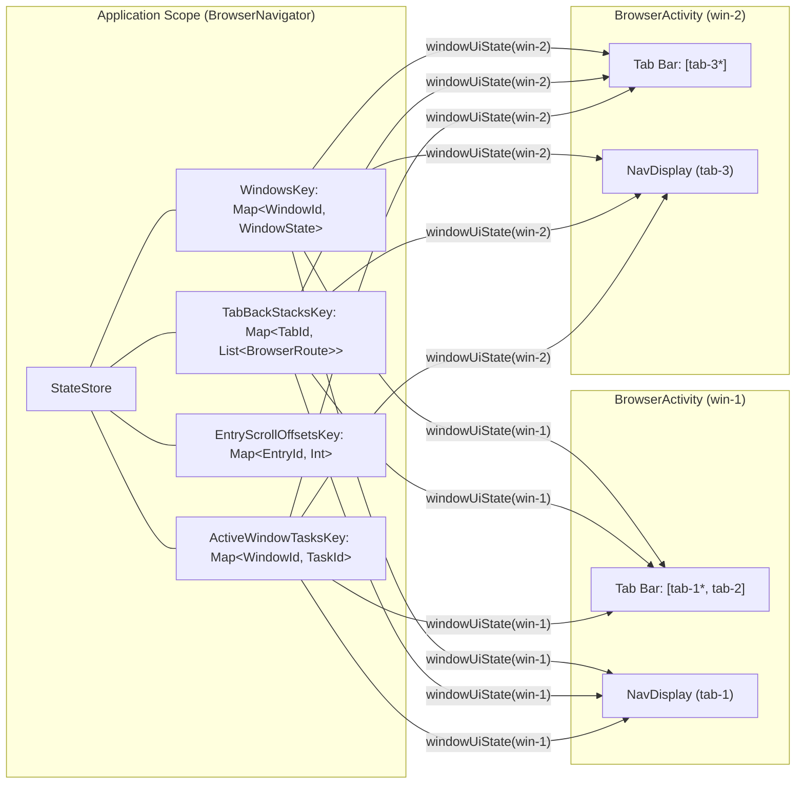

# Browser Recipe: Multi-Window & Multi-Tab Navigation with Navigation 3 and StateStore

This recipe demonstrates how to coordinate **Navigation 3** back stacks across multiple concurrent `Activity` windows and tabs using an application-scoped `StateStore` with DataStore persistence (`PersistToDataStore`).

## Why `StateStore` with Navigation 3?

In a single-`Activity` app, [`rememberNavBackStack()`](https://developer.android.com/guide/navigation/navigation-3/save-state) is sufficient—it provides Compose snapshot observation, configuration-change survival, and `SavedState` restoration.

Hoisting Navigation 3 state into `StateStore` is useful when navigation state must **cross `Activity` boundaries within the same process**. Across phones (split-screen or separate tasks in Recents), foldables, tablets, and desktop windowing, Android can run multiple `Activity` instances concurrently. Because `rememberNavBackStack()` is bound to a single `Activity`, it cannot transfer live tabs between windows. Storing window and tab state in an app-scoped `StateStore` makes cross-window tab tear-off ("Pop out"), drag-and-drop, and merging atomic state updates.



---

## Package Structure

The module separates core `StateStore` + Navigation 3 state management from Android multi-window launching and Compose UI chrome:

- **[`browser/`](src/main/java/com/example/appstaterecipes/browser)**: App and window entry points ([`BrowserApplication.kt`](src/main/java/com/example/appstaterecipes/browser/BrowserApplication.kt), [`BrowserActivity.kt`](src/main/java/com/example/appstaterecipes/browser/BrowserActivity.kt)).
- **[`browser/model/`](src/main/java/com/example/appstaterecipes/browser/model)**: Serializable navigation routes, back-stack keys, and persisted window models ([`BrowserRoute.kt`](src/main/java/com/example/appstaterecipes/browser/model/BrowserRoute.kt), [`EntryId.kt`](src/main/java/com/example/appstaterecipes/browser/model/EntryId.kt), [`BrowserStateModels.kt`](src/main/java/com/example/appstaterecipes/browser/model/BrowserStateModels.kt)).
- **[`browser/state/`](src/main/java/com/example/appstaterecipes/browser/state)**: Core `StateStore` coordination, window-scoped UI sessions, UI read-models, and per-entry scroll persistence ([`BrowserNavigator.kt`](src/main/java/com/example/appstaterecipes/browser/state/BrowserNavigator.kt), [`BrowserWindowSession.kt`](src/main/java/com/example/appstaterecipes/browser/state/BrowserWindowSession.kt), [`BrowserWindowUiState.kt`](src/main/java/com/example/appstaterecipes/browser/state/BrowserWindowUiState.kt), [`EntryScrollStateHolder.kt`](src/main/java/com/example/appstaterecipes/browser/state/EntryScrollStateHolder.kt)).
- **[`browser/window/`](src/main/java/com/example/appstaterecipes/browser/window)**: Multi-instance `Activity` `Intent` builders and freeform window bounds cascading ([`BrowserWindowLauncher.kt`](src/main/java/com/example/appstaterecipes/browser/window/BrowserWindowLauncher.kt)).
- **[`browser/ui/`](src/main/java/com/example/appstaterecipes/browser/ui)**: Window scaffold ([`BrowserWindowScreen.kt`](src/main/java/com/example/appstaterecipes/browser/ui/BrowserWindowScreen.kt)), menus ([`BrowserWindowMenus.kt`](src/main/java/com/example/appstaterecipes/browser/ui/BrowserWindowMenus.kt)), and subpackages for [`tabbar/`](src/main/java/com/example/appstaterecipes/browser/ui/tabbar), cross-window [`dragdrop/`](src/main/java/com/example/appstaterecipes/browser/ui/dragdrop), and destination [`panes/`](src/main/java/com/example/appstaterecipes/browser/ui/panes).

---

## Core Design Patterns

### 1. Separating Window, Tab, and Scroll State
Instead of one monolithic state object, browser state is split across four `StateStoreKey` objects (see [`BrowserNavigator.kt`](src/main/java/com/example/appstaterecipes/browser/state/BrowserNavigator.kt) and [`EntryScrollStateHolder.kt`](src/main/java/com/example/appstaterecipes/browser/state/EntryScrollStateHolder.kt)):

| Key | Type | Persisted | Purpose |
| :--- | :--- | :---: | :--- |
| `WindowsKey` | `Map<String, WindowState>` | Yes | Maps `windowId` to its stable `windowNumber`, ordered `tabIds`, and `activeTabId`. |
| `TabBackStacksKey` | `Map<String, List<BrowserRoute>>` | Yes | Maps `tabId` to its Navigation 3 back stack. |
| `EntryScrollOffsetsKey` | `Map<String, Int>` | Yes | Maps `entryId` (`"$tabId:$stackIndex"`) to its scroll offset in pixels. |
| `ActiveWindowTasksKey` | `Map<String, Int>` | No | Maps `windowId` to the currently attached Android `Activity` `taskId`. |

**Why this split works:**
- **Zero-copy tab transfers:** Moving or popping out a tab between windows only mutates `WindowsKey`. Its back stack in `TabBackStacksKey` and scroll offsets in `EntryScrollOffsetsKey` are untouched, avoiding unnecessary recompositions.
- **Clean memory reclamation:** Because `StateStore` does not remove dynamically generated keys, storing tab stacks inside `TabBackStacksKey`'s immutable `Map` lets `closeTab` drop closed tabs cleanly.
- **Atomic multi-key updates:** Operations touching multiple keys (`openWindow`, `newTab`, `closeTab`, etc.) run inside `Snapshot.withMutableSnapshot { ... }` so observers never see partial state updates.
- **Opt-in persistence per key:** Because individual `StateStoreKey` objects opt in by implementing `PersistToDataStore` (alongside `@Serializable`), durable state (`WindowsKey`, `TabBackStacksKey`, `EntryScrollOffsetsKey`) is saved to DataStore while transient runtime state (`ActiveWindowTasksKey`) stays strictly in-memory.

### 2. Immutable `List<BrowserRoute>` Back Stacks
`NavDisplay` accepts `backStack: List<T>`. Storing an immutable `List<BrowserRoute>` per tab and updating via `stateStore.updateState(TabBackStacksKey) { ... }` avoids putting a mutable collection inside `StateStoreKey.defaultValue`, which would corrupt the singleton default across resets and bypass `StateStore` write notifications.

### 3. Hiding `StateStore` Behind `BrowserNavigator` & `BrowserWindowSession`
UI code never reads or writes `StateStore` keys directly—the keys are encapsulated inside [`BrowserNavigator`](src/main/java/com/example/appstaterecipes/browser/state/BrowserNavigator.kt) (`private`) and [`EntryScrollStateHolder`](src/main/java/com/example/appstaterecipes/browser/state/EntryScrollStateHolder.kt) (`internal`):
- **Encapsulated keys in a shared store:** Multiple features can share a single app-wide `StateStore` without accidentally reading or modifying each other's state.
- **Simple per-window state and actions:** Each window creates a [`BrowserWindowSession`](src/main/java/com/example/appstaterecipes/browser/state/BrowserWindowSession.kt) for its `windowId`. It exposes that window's current UI state (`uiState`) and actions (`navigate`, `goBack`, `newTab`, `selectTab`, `closeTab`, `moveTab`, `popOutTab`, `receiveTabFromWindow`) so composables don't need to pass `windowId` around.

```kotlin
fun closeTab(windowId: String, tabId: String) {
    Snapshot.withMutableSnapshot {
        detachTabFromWindow(windowId, tabId)
        stateStore.updateState(TabBackStacksKey) { tabBackStacks -> tabBackStacks - tabId }
        scrollStateHolder.clearTabs(setOf(tabId))
    }
}
```

### 4. Preserving Scroll Position Across Windows (`BackStackItem` & `EntryScrollStateHolder`)
Each screen on a tab's back stack is wrapped in a [`BackStackItem(tabId, stackIndex, route)`](src/main/java/com/example/appstaterecipes/browser/model/BrowserStateModels.kt) with a unique [`EntryId`](src/main/java/com/example/appstaterecipes/browser/model/EntryId.kt) (`"$tabId:$stackIndex"`), so even duplicate routes on the same tab have separate state.

[`EntryScrollStateHolder`](src/main/java/com/example/appstaterecipes/browser/state/EntryScrollStateHolder.kt) and `rememberEntryScrollState(...)` save and restore each screen's scroll position in `StateStore`:
- **No extra recompositions while scrolling:** Scroll offsets are read only once when a screen enters composition (`Snapshot.withoutReadObservation`) and saved when scrolling stops or the screen leaves composition.
- **Automatic cleanup on back/close:** When a screen is popped or a tab is closed, its saved scroll offset is removed from `StateStore`.
- **Works everywhere:** Scroll position is preserved when switching tabs, visiting the same route twice in one tab, moving a tab to another window, or restarting the app.

---

### 5. Persistence & Startup Restoration (`PersistToDataStore`)

[`BrowserApplication`](src/main/java/com/example/appstaterecipes/browser/BrowserApplication.kt) synchronizes `@Serializable` singleton `PersistToDataStore` keys to disk using `stateStore.syncToDataStore(...)`:

1. **Key priming & awaiting initial restore:** `BrowserApplication.onCreate()` calls `BrowserNavigator(stateStore).primeKeys()` before starting `syncToDataStore` and exposes `initialRestoreComplete: CompletableDeferred<Unit>`. [`BrowserActivity`](src/main/java/com/example/appstaterecipes/browser/BrowserActivity.kt) awaits `initialRestoreComplete` before resolving any incoming window/drag-out `Intent` via [`BrowserWindowLauncher`](src/main/java/com/example/appstaterecipes/browser/window/BrowserWindowLauncher.kt) and calling `navigator.openWindow(...)`, ensuring persisted windows and tabs are hydrated first.
2. **Reattaching vs. closing windows:** `BrowserActivity.onDestroy()` detaches the `Activity`'s `taskId` (`navigator.detachWindowTask(windowId, taskId)`) without removing the window from `WindowsKey`. Unattached windows remain available to reattach on the next launch or via the window switcher, and are only removed when explicitly closed.

> [!NOTE]
> **Known library limitation (detecting initial restore completion):**
> `syncToDataStore` is a never-ending `suspend` function and does not currently expose a callback when the initial disk restore completes. Opening a window before restore finishes would allow `setState(WindowsKey, decoded)` to overwrite the newly created window (or read partially hydrated window/tab keys). `BrowserApplication.initialRestoreComplete` temporarily works around this with a short startup delay on cold process start until initial restore signaling is added to `androidx.appstate`.
