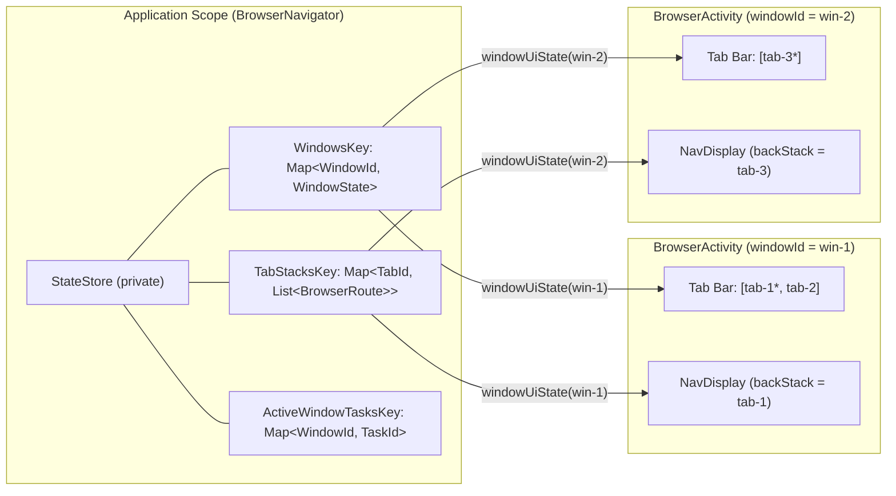

# Recipe: Browser-Style Multi-Window & Multi-Tab Navigation with Navigation 3 and `StateStore`

## When to Use `StateStore` with Navigation 3

In a standard single-`Activity` Compose app where only UI components inside that `Activity` read and write the back stack, hoisting navigation into an application-scoped `StateStore` is unnecessary—`rememberNavBackStack()` already provides Compose snapshot observation, configuration-change survival, and `SavedState` process-death restoration.

Hoisting Navigation 3 back stacks into `StateStore` solves a genuine architectural problem when navigation state must **cross `Activity` or component boundaries within the same process**.

### Scenario: Browser-Style Multi-Tab & Multi-Window Navigation

On large screens, foldables, ChromeOS, and desktop windowing, Android allows an app to run **an arbitrary number of concurrent `Activity` windows** side-by-side (`FLAG_ACTIVITY_NEW_DOCUMENT | FLAG_ACTIVITY_MULTIPLE_TASK | FLAG_ACTIVITY_LAUNCH_ADJACENT`). In a browser-style or document-workspace app:

1. **Multiple windows (`windowId`):** Each `BrowserActivity` instance represents an independent window with its own tab bar.
2. **Multiple tab back stacks (`tabId`):** Every tab has its own full Navigation 3 back stack (`List<BrowserRoute>`).
3. **Cross-window tab tear-off ("Pop out") and merging ("Move to window"):** A user can navigate deep inside a tab (`Home -> Search("compose") -> Article(42)`), **pop that tab out** into a brand-new adjacent `Activity` window (via the menu or Android 15+ cross-window drag-and-drop), or **move/merge the tab** into another existing `Activity` window—preserving its entire Navigation 3 back stack history.

Because `rememberNavBackStack()` is bound to a single `Activity`'s composition and `SavedStateRegistry`, it cannot transfer live back stacks between `Activity` instances. Storing the window registry and tab back stacks in an application-scoped `StateStore` encapsulated behind a `BrowserNavigator` makes cross-window tab transfers a single atomic state update.



---

## Core Design Patterns Used in This Recipe

### 1. Focused Singleton `object` Map Keys (`WindowsKey`, `TabStacksKey`, `EntryScrollOffsetsKey`, `ActiveWindowTasksKey`)
Rather than creating parameterized `data class` keys per tab or putting everything into one monolithic object, state is split across focused singleton keys:
- **`WindowsKey` (`Map<String, WindowState>`):** Maps each `windowId` to its ordered `tabIds: List<String>` and `activeTabId: String` (persisted with `@PersistToDataStore` in [`BrowserNavigator.kt`](BrowserNavigator.kt)).
- **`TabStacksKey` (`Map<String, List<BrowserRoute>>`):** Maps each `tabId` to its Navigation 3 back stack (`List<BrowserRoute>`, persisted with `@PersistToDataStore` in [`BrowserNavigator.kt`](BrowserNavigator.kt)).
- **`EntryScrollOffsetsKey` (`Map<String, Int>`):** Maps each back-stack item's `entryId` (`"$tabId:$stackIndex"`) to its vertical scroll offset in pixels (persisted with `@PersistToDataStore` in [`EntryScrollStateStore.kt`](EntryScrollStateStore.kt)).
- **`ActiveWindowTasksKey` (`Map<String, Int>`):** Tracks which `windowId`s are currently attached to live `BrowserActivity` tasks (`taskId`) in memory ([`BrowserNavigator.kt`](BrowserNavigator.kt)).

**Why this split works well:**
- **Zero-copy tab moves:** Moving `tab-2` from `win-1` to `win-2` (or popping it out into `win-3`) **only mutates `WindowsKey`**. The tab's back stack in `TabStacksKey` is untouched, so no `NavDisplay` observing unaffected tabs recomposes.
- **Clean memory reclamation on tab close:** `StateStore` does not expose a public `removeState(key)` method for dynamically generated keys. Storing tab stacks in `TabStacksKey`'s immutable `Map` allows `closeTab` to drop closed stacks cleanly via `stacks - tabId`.
- **Atomic cross-key updates:** Mutations that touch multiple keys (`ensureWindow`, `newTab`, `closeTab`, `popOutTabToNewWindow`, `moveTabToWindow`, `closeWindow`) are wrapped in `Snapshot.withMutableSnapshot { ... }` so observers never see a partially updated state.
- **`@PersistToDataStore` compatibility:** Because `statestore-datastore` keys persisted entries by `key::class.qualifiedName`, singleton `object` keys avoid storage key collisions, while keeping transient runtime state (`ActiveWindowTasksKey`) out of disk persistence.

### 2. Immutable `List<BrowserRoute>` per Tab (Avoiding the `defaultValue` Singleton Trap)
`NavDisplay` accepts `backStack: List<T>`. Storing an immutable `List<BrowserRoute>` in `TabStacksKey` and updating it via `stateStore.updateState(TabStacksKey) { ... }` avoids storing a mutable `SnapshotStateList` or `NavBackStack` inside `StateStoreKey.defaultValue` (where in-place `.add()` mutations would corrupt the singleton `defaultValue` across resets and bypass `StateStore` assignment listeners).

### 3. Encapsulated `BrowserNavigator` Facade with Consolidated `derivedStateOf` UI State
Raw `StateStore` and `StateStoreKey`s are kept `private` inside `BrowserNavigator`:
- **Shared app-wide `StateStore`, isolated keys:** Multiple features or recipes in the same app share a single `StateStore` instance via `StateStoreOwner` because `WindowsKey`, `TabStacksKey`, and `ActiveWindowTasksKey` are `private` to `BrowserNavigator`.
- **Write safety:** UI screens and `Activity` instances cannot arbitrarily overwrite or clear keys; they call domain methods (`navigate`, `goBack`, `newTab`, `popOutTabToNewWindow`, `moveTabToWindow`, `closeWindow`).
- **Scoped recomposition via `windowUiState(windowId)`:** `navigator.windowUiState(windowId)` returns a `derivedStateOf`-backed `State<BrowserWindowUiState?>` combining the window's active tab, tab bar summaries, active back stack, and open window list.

---

## Key Code Structure

### 1. `@Serializable` Navigation 3 Routes ([`BrowserRoute.kt`](BrowserRoute.kt))

```kotlin
@Serializable
sealed interface BrowserRoute : NavKey {
    val title: String

    @Serializable
    data object Home : BrowserRoute {
        override val title: String = "Home"
    }

    @Serializable
    data class Search(val query: String) : BrowserRoute {
        override val title: String = "Search: $query"
    }

    @Serializable
    data class Article(val id: Int, val headline: String) : BrowserRoute {
        override val title: String = headline
    }
}
```

### 2. Window and Tab Lifecycle Operations in [`BrowserNavigator.kt`](BrowserNavigator.kt)

```kotlin
fun openWindow(
    requestedWindowId: String? = null,
    taskId: Int,
    initialRoute: BrowserRoute = BrowserRoute.Home,
): String = Snapshot.withMutableSnapshot {
    val resolvedId = requestedWindowId
        ?: firstOpenWindowId()
        ?: "win-${idGenerator()}"

    ensureWindow(resolvedId, initialRoute)
    attachWindowTask(resolvedId, taskId)

    resolvedId
}

fun moveTab(
    windowId: String,
    tabId: String,
    toIndex: Int,
) {
    stateStore.updateState(WindowsKey) { windows ->
        val window = windows[windowId] ?: return@updateState windows
        val fromIndex = window.tabIds.indexOf(tabId)
        if (fromIndex == -1 || fromIndex == toIndex) return@updateState windows

        val mutableTabs = window.tabIds.toMutableList()
        mutableTabs.removeAt(fromIndex)
        val targetIndex = toIndex.coerceIn(0, mutableTabs.size)
        mutableTabs.add(targetIndex, tabId)

        windows + (windowId to window.copy(tabIds = mutableTabs))
    }
}

fun popOutTabToNewWindow(
    sourceWindowId: String,
    tabId: String,
): String? = Snapshot.withMutableSnapshot {
    val sourceWindow = stateStore.getState(WindowsKey).value[sourceWindowId]
        ?: return@withMutableSnapshot null
    if (sourceWindow.tabIds.size <= 1 || tabId !in sourceWindow.tabIds) {
        return@withMutableSnapshot null
    }

    val newWindowId = "win-${idGenerator()}"
    detachTabFromWindow(sourceWindowId, tabId)
    stateStore.updateState(WindowsKey) { windows ->
        windows + (newWindowId to WindowState(
            windowId = newWindowId,
            tabIds = listOf(tabId),
            activeTabId = tabId,
        ))
    }
    newWindowId
}
```

### 3. Per-Entry State Preservation Across Windows (`BackStackItem` & `EntryScrollStateStore`)

Each item on the active tab's stack is projected as a `BackStackItem(tabId = activeTabId, index = index, route = route)` and keyed in `NavDisplay` by `clazzContentKey = { it.contentKey }` (where `contentKey` is `"$entryId:$route"` and `entryId` is `EntryId.of(tabId, index).value`). Scroll state is managed by `EntryScrollStateStore` via `rememberEntryScrollState(entryId, scrollStore, isValidEntry = { session.isActiveBackStackEntry(it) })`. Reads use `Snapshot.withoutReadObservation` so scroll writes do not trigger UI recompositions, and disposal updates are guarded so popped entries do not overwrite cleared state. This preserves each back-stack item's scroll position across tab switches, duplicate routes on the same stack, intra-window tab reordering, cross-window tab moves, and app restarts:

```kotlin
val provider = remember(scrollStore, session) {
    entryProvider<BackStackItem> {
        entry<BackStackItem>(clazzContentKey = { it.contentKey }) { item ->
            val scrollState = rememberEntryScrollState(
                entryId = item.entryId,
                scrollStore = scrollStore,
                isValidEntry = { session.isActiveBackStackEntry(item.entryId) },
            )
            when (val route = item.route) {
                is BrowserRoute.Home -> HomePane(scrollState = scrollState, ...)
                is BrowserRoute.Search -> SearchPane(query = route.query, scrollState = scrollState, ...)
                is BrowserRoute.Article -> ArticlePane(article = route, scrollState = scrollState, ...)
            }
        }
    }
}

NavDisplay(
    backStack = uiState.activeBackStackItems,
    onBack = { session.goBack() },
    entryProvider = provider,
    // ...
)
```

---

## Persisting Tabs Across App Restarts (`@PersistToDataStore`)

Because `WindowsKey`, `TabStacksKey`, `WindowState`, and `BrowserRoute` are `@Serializable` and use singleton `object` keys, they work directly with `stateStore.syncToDataStore(...)` in `BrowserApplication`:

1. **Key priming & awaiting restoration on startup (`primeKeys()` + `isRestored`):** `BrowserApplication.onCreate()` calls `BrowserNavigator(stateStore).primeKeys()` before launching `syncToDataStore` and exposes `isRestored: CompletableDeferred<Unit>`, which `BrowserActivity` awaits before calling `navigator.openWindow(...)` so `WindowsKey`, `TabStacksKey`, and `EntryScrollOffsetsKey` are hydrated from disk before a window is opened.
2. **Preserving sessions when leaving `BrowserActivity`:** `BrowserActivity.onDestroy()` detaches the `Activity`'s `taskId` (`navigator.detachWindowTask(windowId, taskId)`) without deleting the window from `WindowsKey`. Unattached windows remain available to reattach on the next launch (`firstOpenWindowId()`) or via the window switcher menu, and are only deleted when the user explicitly closes a window or its last tab.
